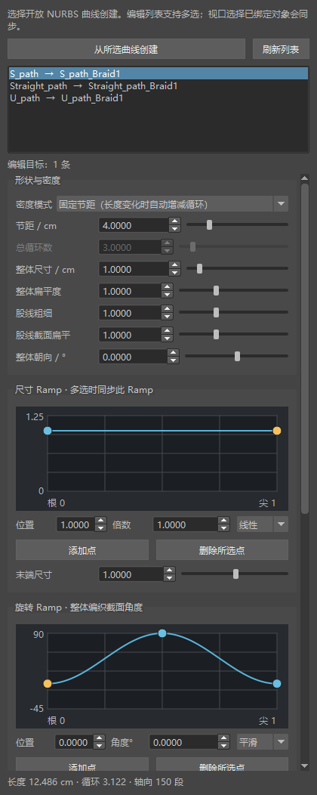

# BraidTools

[中文](README.md) · [Chinese user guide](docs/使用说明.md) · [Changelog](CHANGELOG.md) · [Validation report (Chinese)](docs/验证记录.md)

BraidTools generates editable three-strand braids along open NURBS curves in Windows Maya. It provides a Chinese dockable panel, standalone guide curves for subsequent XGen setup, and baked meshes.

**Status: development preview; no public binary Release yet.** This repository provides source, build scripts and validation records. Build separately for each Maya version. The current node ID is for local development; public binaries require a project-registered ID and renewed verification.

## Compatibility and verification

Windows x64 only. Every Maya major version requires its own `plug-ins/<year>/braidTools.mll`; copying or renaming another version's binary does not provide compatibility.

| Maya | Tested Python / Qt | Build | Isolated functional tests |
| --- | --- | --- | --- |
| 2022 | Python 3.7.7 / Qt 5.15.2 | Passed | 18/18 passed; Python 3 mode only |
| 2023 | Not tested | No binary | Not tested |
| 2024 | Not tested | No binary | Not tested |
| 2025 | Python 3.11.4 / Qt 6.5.3 | Passed | 18/18 passed |
| 2026 | Python 3.11.9 / Qt 6.5.3 | Passed | 18/18 passed |

Each functional suite ran in a separate `mayapy` process with a dedicated profile. All three versions also passed module discovery, version-specific loading, complete panel construction, parameter edits and undo, offscreen ramp drawing and mouse edits, and dialog invocation. Actual GUI dragging, viewport interaction and extended sessions have not yet been retested across these versions for this multi-version package. Offscreen checks are not viewport acceptance tests. The reserved 2023/2024 module entries and build options are not compatibility claims.

The panel uses Maya's bundled PySide2 or PySide6; do not install a separate Qt binding for this tool. Maya 2022 Python 2 mode is unsupported.

## Features and limits

- Live generation from one or multiple open curves; geometry keeps updating with the panel closed.
- Fixed pitch or fixed cycle count, size, flatness, strand shape, orientation and phase.
- Size and local rotation ramps; batch edits affect only the selected parameter.
- Automatic or manual longitudinal resolution, separate cross-section resolution, rebuild and explicit rebind.
- 27 standalone guide curves per braid, optional root disks, and independent baked meshes.
- Undo support for creation, edits, rebuild, rebind, guide extraction and baking.

Closed paths, other strand counts, collision solving, automatic XGen Descriptions, hair materials and UE Groom export are outside this version's scope. Extracted curves are source curves for later XGen conversion.



This image illustrates the panel layout, not completed GUI verification on every Maya version.

## Persistent user installation

These are general manual installation instructions. Installing the module makes its scripts and matching binary discoverable when that user's Maya starts. It does not open the panel automatically. No `Maya.env` or `userSetup.py` edit is required.

`C:/Program Files/Autodesk/Maya2026/modules` is also a valid module location for Maya 2026. The user-level `Documents/maya/modules` location is recommended here for a shared multi-version installation without writing to a program installation directory.

```text
Documents/maya/modules/
├── BraidTools.mod
└── BraidTools/
    ├── BraidTools_Open.py
    ├── scripts/braidtools/
    └── plug-ins/
        ├── 2022/braidTools.mll
        ├── 2025/braidTools.mll
        └── 2026/braidTools.mll
```

Place the complete package in the `BraidTools` folder. Copy its `BraidTools.mod` into the parent `modules` directory, **beside** the folder. The packaged `.mod` is an installation descriptor intended to be copied; its module root is `./BraidTools`. Leaving it only inside the package folder is not sufficient. If an installation already exists, close the relevant Maya sessions, keep a backup, then replace the complete package.

Use the actual Maya user directory if Documents is redirected or `MAYA_APP_DIR` is customized. The source repository excludes `.mll` files; build the required version before installing from source.

Restart Maya and run in the Script Editor's **Python** tab:

```python
import braidtools
braidtools.show()
```

This loads the matching plugin and opens the panel. Open the tool before loading scenes that contain its editable generator nodes. For a session-only trial, drag `BraidTools_Open.py` from a complete package into the viewport.

Select open curves, click “从所选曲线创建” (create from selected curves), then adjust the parameters. Move the source curve to move the braid. “提取 XGen 导向” extracts guide snapshots; “烘焙独立网格” creates independent mesh copies.

For an update, close Maya, back up the existing installation and replace both the package and module descriptor. To disable it, close Maya and move both outside the module search directories. Keep a compatible plugin or baked copies for scenes that still depend on generator nodes. See [Autodesk module documentation](https://help.autodesk.com/cloudhelp/2026/CHS/Maya-DEVHELP/files/Distributing-Maya-Plug-ins/DistributingUsingModules/Maya_DEVHELP_Distributing_Maya_Plug_ins_DistributingUsingModules_ModuleDescriptionFiles_html.html).

## Build and test

The project declares CMake 3.21 as its minimum; also follow the target Maya toolchain requirements (CMake 3.27.3+ for Maya 2025/2026). A Microsoft C++ toolchain supporting C++17 and headers/libraries for the target Maya version are required. Consult that Maya version's Autodesk development requirements. The SDK is not bundled.

Run from the project root in PowerShell to build a local Maya 2026 binary at `plug-ins/2026/braidTools.mll`:

```powershell
cmake -S . -B build/2026 -A x64 -DMAYA_VERSION=2026 -DMAYA_LOCATION="C:/Program Files/Autodesk/Maya2026"
cmake --build build/2026 --config Release
```

Change the version, SDK path and build directory together for another year. CMake checks that the selected SDK matches `MAYA_VERSION`. Do not reuse a build cache across versions or replace a binary loaded in Maya.

The local builds used Visual Studio 2022 / MSVC 19.44. Maya 2022's documented baseline is Visual Studio 2019.7; successful local tests do not imply Autodesk certification for this toolchain combination. [Autodesk Maya 2022 devkit notes](https://help.autodesk.com/cloudhelp/2022/ENU/Maya-SDK/What-s-New-What-s-Changed-/2022-Whats-New-in-API.html)

`tests/integration_maya.py` must run in a new target-version `mayapy` process. Provide `--plugin`, `--scripts`, `--output` and `--profile`; the profile must be a dedicated child of the output directory. Set `BRAIDTOOLS_ISOLATED_TEST=1` and `MAYA_APP_DIR` to that profile. `tests/module_qt_smoke.py` adds module-discovery and offscreen UI checks. Do not execute these tests in an existing interactive Maya session. Sanitize local paths in raw reports before publishing them.

## Public-release requirements

The `braidToolsGenerator` node currently defaults to local development ID `0x0007B7A1`. Before public binary distribution, obtain an Autodesk node ID assigned to this project. An arbitrary replacement number is not registration. See [NOTICE.txt](NOTICE.txt) and [Autodesk's node ID guidance](https://help.autodesk.com/cloudhelp/2022/ENU/Maya-SDK/Maya-Python-API/Dependency-Graph-Plug-in-Basics/Dependency-Graph-Plug-ins.html).

A public build requires `BRAIDTOOLS_PUBLIC_RELEASE=ON`, the assigned `BRAIDTOOLS_NODE_ID`, and `BRAIDTOOLS_REGISTERED_NODE_ID_CONFIRMED=ON` after verifying ownership. The confirmation switch does not perform online registration checks. Rebuild each target and test scene migration, save and reopen after changing the ID; retain the development version for existing scenes until migration is verified.

Source and documentation are provided in this repository. Installation ZIPs and SHA256 checksums are planned for Releases after node ID registration and public-release verification. No public binary download is currently available.

## License

Source is licensed under the [MIT License](LICENSE). Copyright (c) 2026 Hsws9999. Use, modification and commercial redistribution are permitted subject to preservation of the copyright and permission notices.

Autodesk Maya, its SDK and bundled dependencies remain subject to their own terms. Users need their own Maya installation and applicable license.
