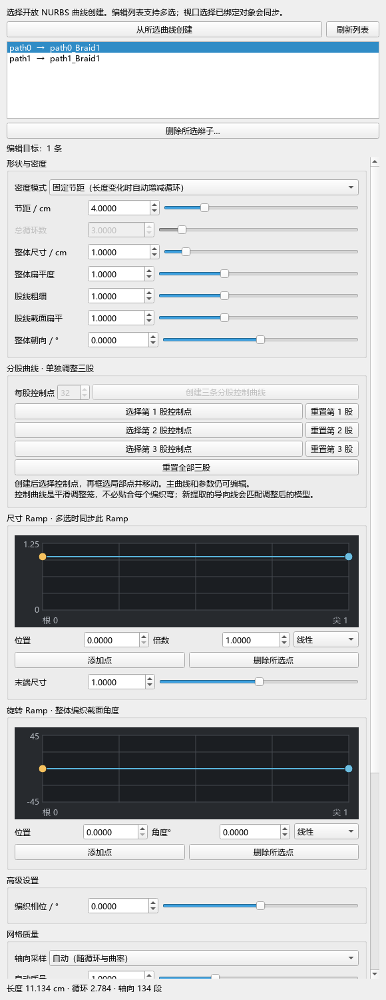

# BraidTools

[English](README.en.md) · [使用说明](docs/使用说明.md) · [变更记录](CHANGELOG.md) · [验证记录](docs/验证记录.md)

**[下载完整学习预览安装包：Windows Maya 2022／2025／2026](https://github.com/Hsws9999/maya-braid-tools/raw/refs/heads/main/downloads/BraidTools_Windows_Maya2022_2025_2026_Learning.zip)**

下载上方 ZIP → 解压整个文件夹 → 在 Maya 中把 `BraidTools_Install.py` 拖入视口。安装包已包含三个年份的 `.mll`，无需自行编译。请使用此完整包；GitHub 的 **Code → Download ZIP** 是仓库源码快照，不是这份可直接安装的插件包。

BraidTools 是面向 Windows Maya 的三股麻花辫建模插件。它沿开放 NURBS 曲线生成可编辑的编织模型，提供中文可停靠面板，并能提取独立的 XGen 源导向曲线和烘焙网格。

**当前状态：1.0.2 学习预览版。** 完整安装包提供 Windows Maya 2022、2025、2026 的自编插件。节点仍使用未注册开发 ID `0x0007B7A1`，可能与使用同一 ID 的其他插件冲突；未来更换注册 ID 时需要处理已有场景迁移。项目采用 MIT 许可证，源码和构建方式同时公开。

## 兼容性与验证范围

仅面向 Windows x64。每个 Maya 主版本都需要对应的 `plug-ins/<年份>/braidTools.mll`，不能通过复制或改名跨版本使用。

| Maya | Python / Qt 实测环境 | 编译 | 当前源码的隔离功能验收 |
| --- | --- | --- | --- |
| 2022 | Python 3.7.7 / Qt 5.15.2 | 通过 | 18/18 通过；仅支持 Python 3 模式 |
| 2023 | 未验证 | 无产物 | 未验证 |
| 2024 | 未验证 | 无产物 | 未验证 |
| 2025 | Python 3.11.4 / Qt 6.5.3 | 通过 | 18/18 通过 |
| 2026 | Python 3.11.9 / Qt 6.5.3 | 通过 | 18/18 通过 |

上述功能验收在每个版本独立的 `mayapy` 进程与测试设置目录中运行。三版还通过了模块自动发现、按版本加载、完整面板构建、参数修改与撤销、离屏 Ramp 绘制及鼠标编辑、对话框调用的补充检查。当前多版本包尚未完成各版本真实 GUI 拖动、视口及长时间运行复验；离屏检查不等于真实视口验收。

三版均在含**中文和空格**的隔离用户目录中通过模块自动发现、实际 `.mll` 加载、27 条导向生成，以及中文场景路径保存重开。**不要求全英文路径**；其他任意 Unicode 字符组合未逐一验证。

界面使用 Maya 自带的 PySide2 或 PySide6，无需另外安装 Qt。Maya 2022 的 Python 2 模式不受支持。2023、2024 的模块条目与构建参数只是预留，不能作为兼容性结论。

## 功能

- 一条或多条开放路径生成三股模型，编辑路径 CV 时由依赖图更新；关闭面板后关联仍保留。
- 固定节距／固定周期、整体尺寸、辫子与单股扁平度、朝向和相位。
- 尺寸分布与局部旋转 Ramp，支持多选时仅修改当前参数。
- 自动／手动纵向精度、独立截面精度、曲线重建和显式重新绑定。
- 每条辫子提取 27 条独立源导向曲线，可附带三个根部圆盘；支持烘焙独立网格。
- 列表支持“删除所选辫子…”：确认后删除所选实时资产，保留源曲线及独立快照；支持单选、多选与一次撤销。
- 创建、删除、调参、重建、重新绑定、提取和烘焙提供撤销操作。

不支持闭合路径、其他股数或发束碰撞求解；不自动创建 XGen Description，不包含毛发材质或 UE Groom 导出。输出源导向仍需在 XGen 中继续设置。



截图展示 1.0.0 的面板布局；1.0.1 在列表下方新增“删除所选辫子…”。截图不代表所有 Maya 版本的界面均已通过复验。

## 拖入安装，长期使用

1. 下载页首的完整安装 ZIP，并解压全部内容，保留子文件夹结构。
2. 打开 Windows Maya 2022、2025 或 2026，将解压后的 `BraidTools_Install.py` 拖入视口。Maya 2022 使用 Python 3 模式。
3. 在安装窗口核对目标目录和 Shelf 影响后点击“安装”；Maya 的脚本许可按其提示确认。首次正常安装会打开面板，并添加 **BraidTools** 工具架上的**金色麻花辫图标**，以后点击图标即可打开。

图标采用金色几何麻花辫造型，随包提供 32、64、128 像素透明 PNG，供 Maya 按按钮尺寸选择。该图标仅用于新建按钮；已有工具架和按钮保持原样，不自动替换旧图标或升级既有安装。

安装器根据 Maya 的实际用户目录把文件安装到 `modules/BraidTools`，在 `modules` 顶层放置 `BraidTools.mod`，并保存专属 Shelf 按钮。通常位于 `Documents/maya/modules`；文档目录被重定向或使用自定义 `MAYA_APP_DIR` 时，以 Maya 返回的用户目录为准。安装无需管理员权限，不改 `Maya.env` 或 `userSetup.py`。

典型安装结构如下：

```text
Documents/maya/modules/
├── BraidTools.mod
└── BraidTools/
    ├── BraidTools_Open.py
    ├── icons/
    ├── scripts/braidtools/
    └── plug-ins/
        ├── 2022/braidTools.mll
        ├── 2025/braidTools.mll
        └── 2026/braidTools.mll
```

相同内容、由本安装器管理的完整安装可重复运行；不同版本、不完整安装或非本安装器管理的同名目录会被拒绝覆盖，本版本不自动升级。若当前会话已经加载另一目录的 BraidTools，会先完成磁盘安装，提示保存并重启，再从原解压目录拖入安装器一次。已有同名用户 Shelf 不会被覆盖，可按提示拖入已安装目录的 `BraidTools_Open.py` 打开。更新与停用方法见[使用说明](docs/使用说明.md)。

如需手动安装，将包放入 `modules/BraidTools`，把包内 `.mod` 复制到 `modules` 顶层与文件夹并排，然后重启 Maya。`C:/Program Files/Autodesk/Maya2026/modules` 也是该年份的有效模块目录；本包默认使用用户目录，方便多个年份共用。

Shelf 按钮之外，也可以在 Script Editor 的 **Python** 页签运行：

```python
import braidtools
braidtools.show()
```

可编辑场景需要对应插件；重新启动后，先打开工具，再打开含生成节点的场景。`BraidTools_Open.py` 只用于从解压目录临时打开当前会话，不替代长期安装器。

更新、卸载与详细操作见[使用说明](docs/使用说明.md)。模块路径规则见 [Autodesk 模块文档](https://help.autodesk.com/cloudhelp/2026/CHS/Maya-DEVHELP/files/Distributing-Maya-Plug-ins/DistributingUsingModules/Maya_DEVHELP_Distributing_Maya_Plug_ins_DistributingUsingModules_ModuleDescriptionFiles_html.html)。

## 从源码编译（开发者）

使用完整安装包不需要以下步骤。源码开发者可按目标 Maya 年份自行编译。

项目声明的 CMake 最低版本为 3.21；实际构建还应遵循目标 Maya 的官方工具链要求（Maya 2025/2026 为 CMake 3.27.3 或更新版本）。另外需要支持 C++17 的 Microsoft C++ 工具链，以及目标 Maya 版本的开发头文件和库。使用该 Maya 版本的 Autodesk 开发环境要求选择工具链。SDK 不随本项目提供。

以下 PowerShell 命令在项目根目录生成 Maya 2026 的本地开发构建，输出为 `plug-ins/2026/braidTools.mll`：

```powershell
cmake -S . -B build/2026 -A x64 -DMAYA_VERSION=2026 -DMAYA_LOCATION="C:/Program Files/Autodesk/Maya2026"
cmake --build build/2026 --config Release
```

构建其他年份时，同时更换 `MAYA_VERSION`、`MAYA_LOCATION` 和构建目录；CMake 会检查年份与 SDK 是否一致。不要复用不同年份的构建缓存，也不要覆盖正在被 Maya 加载的 `.mll`。

本次三个版本的本地构建均使用 Visual Studio 2022 / MSVC 19.44。Maya 2022 的官方工具链基线为 Visual Studio 2019.7；这里记录的是实际编译及运行结果，不代表 Autodesk 对该工具链组合的认证。[Autodesk Maya 2022 devkit 更新](https://help.autodesk.com/cloudhelp/2022/ENU/Maya-SDK/What-s-New-What-s-Changed-/2022-Whats-New-in-API.html)

`tests/integration_maya.py` 提供隔离验收。使用目标版本的 `mayapy`，为每次运行设置独立的 `--output` 和位于其中的 `--profile`，同时设置 `BRAIDTOOLS_ISOLATED_TEST=1` 和匹配的 `MAYA_APP_DIR`。`tests/module_qt_smoke.py` 补充验证模块发现和离屏界面行为。不要在已有交互 Maya 会话中执行这些测试。原始报告可能包含本机路径，公开前需要清理。

## 节点 ID 与正式发行构建

Autodesk 的技术文档要求共享的依赖图插件使用全球唯一节点 ID。本学习预览的 `braidToolsGenerator` 仍使用**未注册**开发 ID `0x0007B7A1`，不代表已经获得分配；同一 ID 被其他插件占用时可能加载冲突。详见 [NOTICE.txt](NOTICE.txt) 和 [Autodesk 节点 ID 说明](https://help.autodesk.com/cloudhelp/2022/ENU/Maya-SDK/Maya-Python-API/Dependency-Graph-Plug-in-Basics/Dependency-Graph-Plug-ins.html)。

当前学习预览使用默认开发构建。项目另保留 `BRAIDTOOLS_PUBLIC_RELEASE` 作为**采用注册 ID 的正式发行构建模式**，该模式同时要求：

| CMake 参数 | 要求 |
| --- | --- |
| `BRAIDTOOLS_PUBLIC_RELEASE` | `ON` |
| `BRAIDTOOLS_NODE_ID` | 本项目实际获分配的节点 ID |
| `BRAIDTOOLS_REGISTERED_NODE_ID_CONFIRMED` | 核实注册归属后设为 `ON` |

确认开关仅记录维护者的确认，构建系统不会联网验证注册。变更 ID 后需重新编译各版本并验证场景保存、重开与迁移；不要直接替换仍在使用开发 ID 场景的安装。

学习预览完整 ZIP 位于仓库 `downloads` 目录，入口见页首。后续采用注册 ID 的正式版本需重新编译并验证，不应直接替换尚未迁移的开发版场景。

## 许可证

本项目源码采用 [MIT 许可证](LICENSE)，版权署名为 2026 Hsws9999。允许使用、修改和商业再分发，需保留版权和许可声明。

Autodesk Maya、其 SDK 及随 Maya 提供的依赖仍适用各自条款。使用本工具需要用户自己的 Maya 安装及相应许可。
